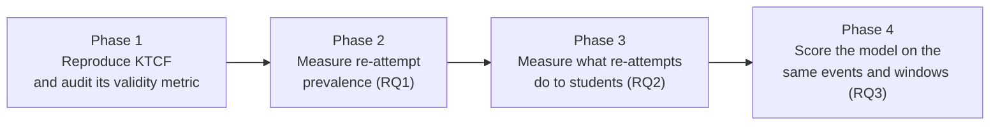

# kt-recourse-calibration

## Study 1: Do knowledge tracing models know what their recommended interventions do?

Counterfactual recourse methods for knowledge tracing (KT) tell a student which past mistakes to go back and fix so that the model would predict success on the next question. They score those recommendations by asking the same model whether its prediction improves. That assumes the model can predict what fixing a mistake actually does to a student. This repository tests that assumption on real data: it reproduces a published recourse method (KTCF, AAAI 2026), measures what re-attempts actually do to students in a large public dataset (XES3G5M), and compares the model’s counterfactual predictions with what happened.

Study 1 is complete. Findings are summarised below; the technical record is in `docs/`.

---

### Findings

**1. The published method’s validity score does not measure its recommendations.** KTCF reports that 93% of its recommendations are “valid” (the model flips from predicting failure to predicting success). We reproduced that number from the released code. But the model is scored on a vector of fractional values, which its embedding lookup turns into a history of *other* concepts the student never practised. Scored on the actual recommendation (the student’s real answers with the flagged mistakes marked correct), validity is 76.5%, and it is 76.5% for a coin-flip recommendation too. Which mistakes get flagged is decided by the sign of a random initialization and never changed by the optimizer. Details: `docs/validity_explainer.md` (explanation), `docs/reproduction.md` (full record).
> Reference: `docs/exploration/2026-10-31_ktcf_validity_diagnostic_rn.log` and `_rand.log` (conditions c and d; sparsity init vs final). The five-scheme table in `docs/reproduction.md` §4. Paper figure from Table 1 of the KTCF paper.

**2. Re-attempts are common, and overwhelmingly on multiple-choice questions.** 3.35% of all interactions in XES3G5M are re-attempts of a question the student already answered; 81% of students have at least one. A quarter are corrections (previous attempt wrong), three quarters reviews (previous attempt right). 87% of re-attempts are on single-choice items, which are only 30% of interactions.
> Reference: `docs/exploration/2026-10-31_rq1_prevalence.log`: `rq1_overall`, `rq1_by_kind`, `rq1_by_qtype` (pooled rows)

**3. A student who redoes a wrong answer gets it right 77% of the time, but most of that is format and recency.** Net of chance on multiple-choice retries, success is 68% for both question formats. Within an hour of the first attempt, when the platform has just shown the solution, success is 87%; after a week it is 61%, and on hard multiple-choice items a week later it is 28% net of chance.
> Reference: `docs/exploration/2026-11-01_rq2_observed_effects_kclevel2.log`: `rq2_correction_by_split`, `rq2_correction_by_qtype_chance_n-1`, `rq2_correction_by_gap`, `rq2_correction_by_gap_x_tercile_x_qtype_chance_n-1`

**4. Students forget on a measurable curve.** Retention on reviewed questions falls from 97% within an hour to 82% after a week; the odds of retention drop by 42% for every tenfold increase in elapsed time. The KT model used by KTCF has no representation of time.
> Reference: `docs/exploration/2026-11-01_rq2_observed_effects_kclevel2.log`: `rq2_review_by_gap`; `rq2_h2b_retention_vs_loggap` (odds_ratio_per_10x_gap = 0.58)

**5. Actually fixing a mistake moves later performance by about 3 points.** Matched against students who answered the same kind of question the same way and did not go back, students who corrected a mistake scored 2.7 percentage points higher on their next 10 questions in the same strand of mathematics (CI 2.1 to 3.2). Reviewing a question already answered correctly changed nothing.
> Reference: `docs/exploration/2026-11-01_rq2_observed_effects_kclevel2.log`: `rq2_h2c_matched_change_kclevel2`, rows `kind=correction` and `kind=review`; deviation rationale in `docs/exploration/2026-11-01_kc_level_check.log`. Data: `data/processed/rq2/rq2_h2c_pairs_kclevel2.csv`

**6. The model’s prediction for one correction is the right size on average, and uninformative beyond that.** On the same students and the same windows, the released model predicts a lift of 2.6 points from one corrected mistake; the observed lift is 1.9 to 2.7. But the model predicts the same 2.6 points for every correction, while the real effect ranges from −3 points (retry failed) to +3.5 (retry succeeded) and differs by timing and format. A model whose estimated benefit is the same for every mistake cannot rank which mistakes to fix.
> Reference: `docs/exploration/2026-11-01_rq3_score_events.log`: `rq3_B_counterfactual_lift_kclevel2`, columns `pred_lift_flip` and `obs_lift`, rows `all`, `repeat succeeded`, `repeat failed`. Data: `data/processed/rq3/` (`rq3_A_events.csv`, `rq3_B_pairs_scored_kclevel2.csv`, `rq3_C_multiflip_pairs_kclevel2.csv`).

**7. The model cannot predict the re-attempt itself.** Its prediction that a student will succeed on the retry is flat at 69–73% across elapsed time, while actual success runs from 87% (within an hour) to 59% (after a week). It is too pessimistic about immediate retries by 15 points and too optimistic about week-later ones by 10.
> Reference: `docs/exploration/2026-11-01_rq3_score_events.log`: `rq3_A_reattempt_calibration`, rows `all` and `gap_class=*` (columns `mean_pred`, `observed`, `gap`). Data: `data/processed/rq3/` (`rq3_A_events.csv`, `rq3_B_pairs_scored_kclevel2.csv`, `rq3_C_multiflip_pairs_kclevel2.csv`).

**8. The model’s own prediction for a full KTCF recommendation is modest.** Flipping half of a student’s mistakes, the number KTCF’s rule produces, is predicted to raise next-10 same-strand accuracy by 8.4 points; the value of each additional flip falls to 0.4 points. The 0.34 → 0.7 change the paper reports is a property of how the target position is scored, not a prediction about the student’s subsequent performance.
> Reference: `docs/exploration/2026-11-01_rq3_multiflip.log`: rows `k=half` and `k=25`(`pred_lift`, `lift_per_flip`). Data: `data/processed/rq3/` (`rq3_A_events.csv`, `rq3_B_pairs_scored_kclevel2.csv`, `rq3_C_multiflip_pairs_kclevel2.csv`).

**What this does and does not show.** Nobody in the data followed a recommendation; re-attempts are observational and self-selected. These results test whether the model’s counterfactual predictions are calibrated against the effects of corrections that occurred, which is a necessary condition for a recommendation to deliver what it promises. They do not test the effect of recommending corrections; that requires a user study.

---

### How Study 1 works



**Phase 1, reproduction and diagnostic.** KTCF’s released DKT checkpoint and Table 1 were reproduced on the released 200-student sample (`docs/reproduction.md`). A diagnostic (`src/audit/ktcf_validity_diagnostic.py`) calls KTCF’s own initializer and optimizer unchanged, then re-asks the model for its prediction under six views of the same output: the original responses, the random initialization (raw and masked), the final continuous vector the paper scores, and the binarized recommendation under two threshold rules. Run for all five initialization schemes. The KTCF code is used as released; the only patches are those needed to run it, listed in `docs/reproduction.md` §3.

**Phase 2, prevalence.** `src/audit/reconstruct.py` builds one clean interaction table from the raw dataset (train and test, timestamps, concept per question), identifies every re-attempt of a question in a later batch, and labels it correction or review with its time gap. `src/audit/difficulty.py` assigns each question an easy/medium/hard tercile from first-attempt accuracy on the training split. `src/audit/prevalence_tables.py` reports re-attempt counts and shares by kind, gap, difficulty, question type, attempt number, and position in the student’s history, per split and pooled.

**Phase 3, observed effects.** `src/audit/observed_effects.py` estimates, with 95% confidence intervals from resampling students, (a) correction success and review retention by gap, difficulty, and question type, with multiple-choice success reported net of chance; (b) a logistic regression of review retention on log elapsed time; (c) a matched comparison in which each re-attempt is paired with a first attempt on the same strand by a student who never redid that question, matched on split, strand, history length, prior accuracy, and first-attempt result, with the outcome being the change in accuracy over the next 10 same-strand questions. The unit for the matching and windows is the second level of the dataset’s concept hierarchy (53 strands); at the finest concept level almost no student has 10 interactions on each side (`src/audit/kc_level_check.py`).

**Phase 4, calibration.** `src/calibration/score_events.py` loads the released checkpoint, encodes each test-split student’s history as the model expects, and (A) predicts every correction retry and compares with the outcome (reliability table, ECE, AUC, by gap, type, difficulty); (B) for every matched pair, predicts accuracy over the same next-10 window with and without the first attempt flipped to correct, and compares the predicted lift with the observed one. `src/calibration/score_multiflip.py` repeats (B) while flipping 1 to half of the student’s mistakes. Only the released model is scored; retraining and other model families are future work.

---

### Repository layout

```
docs/
  reproduction.md           KTCF reproduction: patches, Table 1, five-scheme validity diagnostic, code facts
  validity_explainer.md     the validity gap explained for readers without the paper or the code
  exploration/              every run's log, dated; diagnostic CSVs
src/
  common/                   paths and device helpers
  audit/                    reconstruct.py, difficulty.py, prevalence_tables.py, observed_effects.py,
                            kc_level_check.py, ktcf_validity_diagnostic.py, exploration scripts
  calibration/              score_events.py, score_multiflip.py
data/
  raw/XES3G5M/              dataset as downloaded (not tracked)
  processed/                clean parquet, item difficulty, rq1/, rq2/, rq3/ tables (not tracked)
```

### Reproducing

Requirements: Python 3.12, `uv`, the XES3G5M dataset under `data/raw/XES3G5M/` (the pyKT download plus `metadata/questions.json`), and a sibling checkout of KTCF with its released checkpoint at the path set in `.env` (`KTCF_ROOT`). Phase 1 additionally follows the setup in `docs/reproduction.md` §2–3.

```
uv sync
uv run python src/audit/reconstruct.py
uv run python src/audit/difficulty.py              | tee docs/exploration/<date>_xes3g5m_difficulty.txt
uv run python src/audit/prevalence_tables.py       | tee docs/exploration/<date>_rq1_prevalence.log
uv run python src/audit/kc_level_check.py          | tee docs/exploration/<date>_kc_level_check.log
uv run python src/audit/observed_effects.py --kc_level 2 --chance n-1 \
                                                   | tee docs/exploration/<date>_rq2_observed_effects_kclevel2.log
uv run python src/calibration/score_events.py --kc_level 2 \
                                                   | tee docs/exploration/<date>_rq3_score_events.log
uv run python src/calibration/score_multiflip.py --kc_level 2 \
                                                   | tee docs/exploration/<date>_rq3_multiflip.log
```

For the KTCF diagnostic, from the repo root: `uv run python src/audit/ktcf_validity_diagnostic.py --init_scheme N` for N in 1–5.

All scripts are seeded; reruns are byte-identical on CPU. Every number in this README traces to a log in `docs/exploration/`.

### Dataset

XES3G5M (Liu et al., NeurIPS 2023): 18,066 students, 5.5 million interactions, 7,652 questions, timestamps, a five-level knowledge-component hierarchy, and question text and type. It is the dataset KTCF was evaluated on, which is what makes the comparison possible. ASSISTments and EdNet-KT1, named previously, were not needed.

#### What this study does not claim

Observed effects are associations, not causal estimates: students who re-attempt differ from students who do not, and public logs contain no randomized interventions. The calibration test is a necessary condition for recourse to work, not evidence that it does. One dataset, one platform, one subject, one released model.

### Status

Study 1 complete (October 2026). The KTCF authors have been contacted about the validity finding; their response will be reflected here.

## Study 2: research question and claims

**Question.** For a student at a given moment, which past questions, if re-attempted now, would most
improve their subsequent performance compared with attempting a new question in the same area — and
can that be verified from what logged students actually did afterwards?

**Why this replaces the KTCF question.** KTCF asks which past wrong answers, if flipped, would make the
student model predict the target correct. That (a) excludes reviews of correct items, (b) ignores time
since last attempt, and (c) is scored by the same model that made the prediction, which Study 1 showed
is not calibrated across gaps.

**Primary outcome.** Observed treated-minus-control gain in the top 20% of each ranking (Qini
framing), where treated = logged re-attempts and control = matched new-item events in the same area,
on held-out students. Outcomes: next-5 same-area accuracy (primary), same-item next-encounter
correctness (secondary), next-20 same-area (exploratory).

**Primary comparison.** Lift-based ranking (τ_LCB) vs predicted-correctness ranking (the student
model's P(correct), KTCF's signal) vs random. Decision rule fixed in advance: report τ_LCB; use τ_DR only
to confirm that propensity adjustment does not reverse the ranking.

**Secondary analyses.** Headroom subgroup (recent same-area accuracy < 0.8); new-practice policy;
review timing; set-level (k = 5) realized outcomes where same-item repeats are dense.

**Claims we make.** (1) The naive observational effect of re-attempting is dominated by selection.
(2) On three platforms, reviews ranked by causal lift are followed by larger gains than reviews
ranked by predicted correctness, which is no better than random. (3) The model identifies corrections
that should be replaced by new practice. (4) The student model's self-scored validity cannot
distinguish recommendation methods.

**Claims we do not make.** That a recommended study list, delivered to a student, improves their
performance. The data are observational; re-attempts were chosen by students and platform
schedulers; the method ranks them after the fact with propensity weighting. The delivered
recommendation can only be tested by randomized assignment.

**Known limitations.** Gradient-boosted history model stands in for a DKT on SLAM and ASSISTments;
one-flip approximation of KTCF on those datasets; item-level outcome underpowered on XES3G5M;
timing not identifiable from any of the three logs; set-level evaluation possible only on SLAM and
null there on content words.