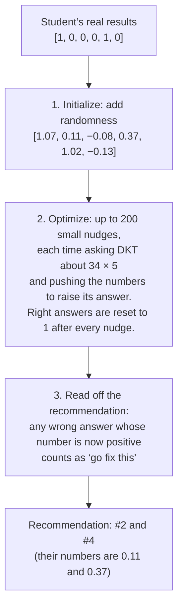

# Why KTCF’s “97.5% valid” is really “76.5% valid”

This note explains what the KTCF method claims to do, what it actually does, and why the validity numbers its code reports (0.70–0.975 depending on setting, in our rerun; 0.685–0.930 in the paper) are not the validity of the advice it gives (0.55–0.765). It is written for someone who has not read the paper or the code. The technical record is in `reproduction.md` §4; the per-student results are in `docs/exploration/2026-10-31_ktcf_validity_diagnostic_*.csv`.

## 1. What KTCF is supposed to do

A *knowledge tracing* model watches a student answer questions and keeps a running guess of what they know. KTCF uses one called DKT. Here is a grade 3 student, six questions in:

| # | Question | Concept | Result |
| --- | --- | --- | --- |
| 1 | 3 × 4 | single-digit multiplication | right |
| 2 | 7 × 10 | multiplying by 10 | wrong |
| 3 | 6 × 8 | single-digit multiplication | wrong |
| 4 | 23 × 3 | two-digit × one-digit | wrong |
| 5 | 40 × 2 | multiplying by 10 | right |
| 6 | 12 × 4 | two-digit × one-digit | wrong |

The next question is 34 × 5 (two-digit × one-digit). DKT looks at the six results and says: 34% chance this student gets it right. That is a prediction of failure.

KTCF’s job is to answer the student’s natural follow-up: *what should I go back and fix so that I would get 34 × 5 right?* It is meant to return a short list of earlier mistakes, for example “redo 7 × 10 and 23 × 3,” chosen so that if those were correct, DKT would predict success instead. The paper calls this a *counterfactual explanation*; the list is the student’s *recourse*.

## 2. What “validity” should mean

The paper scores its recommendations on *validity*: the share of students for whom the recommendation flips DKT’s prediction from “wrong” to “right.” A reader naturally understands this as:

> Take the student’s record, mark the recommended questions as correct, show the record to DKT again, and see whether it now predicts success.

For the example student: change #2 and #4 from wrong to right, leave the other four alone, ask DKT about 34 × 5 again. If it now says above 50%, the recommendation is valid.

The paper reports validity of 0.930 for its best setting (rn). We reran the released code on the released model and the same 200 students and got 0.975, within the paper’s own error bar (the difference comes from CPU versus GPU random numbers). The number reproduces. The problem is what it measures.

Every comparison from here on uses our rerun on both sides, so the two validities being compared are computed on exactly the same output vectors. The paper’s printed numbers are listed alongside for reference.

## 3. How the method actually works

KTCF does not search over lists of questions. It works with a *response vector*: one number per past question, 1 for right and 0 for wrong. For the example, that is `[1, 0, 0, 0, 1, 0]`. The method then runs in three steps.

**Step 1, initialize.** The method cannot nudge a 0 or a 1, so it first turns the vector into ordinary decimals by adding randomness. The paper tests five ways of doing this (called rn, rand, sr, cc, gs); the default, rn, adds a small random amount to every entry.

**Step 2, optimize.** Up to 200 times, it shows the current decimal vector to DKT, reads DKT’s prediction for 34 × 5, and nudges each wrong-answer entry a little in whichever direction raises that prediction. Right answers are put back to exactly 1 after every nudge, so the method can only ever recommend fixing mistakes.

**Step 3, read off.** When the loop stops, any wrong answer whose number is positive is counted as “flipped to correct.” Those are the recommended questions.

Validity, as the paper computes it, is DKT’s prediction at the end of step 2: the prediction on the final *decimal* vector. The recommendation in step 3 is read off the same vector, but DKT is never asked about it.

## 4. Where it goes wrong

### 4.1 Which questions get recommended is decided by a coin, not by the optimizer

In step 3, an answer counts as flipped if its number is positive. In step 1, every wrong answer starts at 0 plus a random amount, so about half of them start positive. Step 2 nudges each entry by roughly 0.01 per round, while the random amounts are typically ±0.1 or larger, so an entry almost never changes sign.

Result: the set of recommended questions is fixed before the optimizer runs. For the example, #2 and #4 are recommended because their random draws (0.11, 0.37) happened to be positive and #3 and #6 are not because theirs (−0.08, −0.13) happened to be negative. The optimizer confirmed this rather than chose it. Across 200 real students the number of recommended questions was 54.0 before optimization and 52.5 after, out of 108.5 mistakes on average: half, as a coin would give.

### 4.2 DKT is asked about a different student

DKT does not read “concept 2, wrong” as two facts. Its first layer is a lookup table with one row per (concept, right-or-wrong) pair, and it finds the row with a single formula: **row = concept + 865 × result**, where 865 is the number of concepts in the dataset. Result 0 gives row `concept`; result 1 gives row `concept + 865`. The model was trained only on those rows.

In the example, question #4 is concept 2 (two-digit × one-digit). With a real answer:

| Result | Row | What the row means |
| --- | --- | --- |
| 0 (wrong) | 2 + 865 × 0 = **2** | two-digit × one-digit, wrong |
| 1 (right) | 2 + 865 × 1 = **867** | two-digit × one-digit, right |

With the decimal value 0.37 from step 1:

| Result | Row | What the row means |
| --- | --- | --- |
| 0.37 | 2 + 865 × 0.37 = 322.05 → **322** | *concept 322*, wrong |

Concept 322 is some unrelated topic the student never practised. Every entry that is not exactly 0 or 1 lands on a row belonging to some other concept, and in the real data that is every one of the student’s ~108 mistakes. So the history DKT is shown in step 2, and the history its “97.5% valid” verdict refers to, is not “this student with some answers corrected.” It is a student with the same pattern of rights and wrongs but ~108 of the concepts swapped for random other ones. We call this *index drift*; the diagnostic counts how many positions have it.

Small decimals do not mean small drift: 0.11 moves 95 rows, 0.37 moves 320. Under the sr and gs settings, where the decimals run to ±4, the lookups land anywhere in the table. And under gs the transform is applied to the right answers too, so even the student’s correct results are read on the wrong row.

### 4.3 What the right measurement gives

The diagnostic adds a step: build the record the recommendation actually describes (`[1, 1, 0, 1, 1, 0]` for the example: #2 and #4 marked right, everything else as it was), every entry exactly 0 or 1, every lookup on the student’s own concept, and ask DKT once more. We call the result *binarized validity*.

| Setting | Paper’s printed validity | Reported validity, our rerun (decimal vector) | Binarized validity (the actual recommendation) | Positions drifted at the end, of 199 |
| --- | --- | --- | --- | --- |
| rn (default) | 0.930 | 0.975 | **0.765** | 108 |
| rand | 0.720 | 0.765 | **0.765** | 0 |
| sr | 0.930 | 0.945 | **0.760** | 108 |
| cc | 0.685 | 0.700 | **0.765** | 54 |
| gs | 0.920 | 0.925 | **0.550** | 154 |

Two things stand out. First, rand, the one setting whose vector is always exactly 0/1 (no drift), gives the same number both ways: 0.765. Remove drift and the two measures agree. Second, the ranking of settings (rn ≈ sr > gs > rand > cc, in both the paper and our rerun) is a ranking of how much drift each produces; the recommendations themselves validate at the same ~0.76 for four of the five.

The fifth, gs, recommends fewer questions (35 instead of 54, because its cutoff sits above zero), and that is the whole reason it scores lower. Lining up every setting and cutoff we tested by *how many* mistakes get flipped:

| Mistakes flipped (mean) | Binarized validity |
| --- | --- |
| 0 | 0.000 |
| 27 | 0.440 |
| 34–35 | 0.525–0.550 |
| 52–54 | 0.760–0.765 |

Binarized validity is a function of the number of randomly chosen mistakes you mark as fixed, and of nothing else. Which setting generated the list does not matter.

## 5. What this does and does not mean

**It does not mean the recommendations are bad advice.** A student who redoes half their mistakes probably does learn something; we have not measured that yet.

**It does mean the paper’s validity number is not evidence about the advice.** It is DKT’s opinion of a scrambled history. The other version of the same number is 0.765 (or 0.55 for gs), and that number would be the same if the questions had been picked by a coin, because they effectively were.

**It also does not yet tell us what happens to real students.** Even binarized validity is DKT predicting that a *hypothetical record* would look like success. Whether a student who actually goes back and reviews those questions then gets the target right is a separate question. The XES3G5M dataset contains students who, on their own, went back and re-attempted questions they had got wrong, and it records how they did afterward. Nobody was following a recommendation, so this is observation rather than a trial, but it lets us check whether DKT’s predictions after a correction line up with what actually happened to students who made that correction.

**The bar any recourse method has to clear:** beat “flip a random half of your mistakes,” which validates at 0.765 by DKT’s own measure and costs nothing to compute.

## Appendix: terms to code

| In this note | In the code (`ktcf-work`) |
| --- | --- |
| response vector | `r` (`original_r`); counterfactual version `cf_r` |
| step 1, initialize | `init_cf.py`, `initialize_response(params, r)`; settings rn/rand/sr/cc/gs are `init_scheme` 1–5 |
| step 2, optimize | `cf_generator.py`, `KTCF.generate_cf_dkt`; the nudge is one Adam step on `cf_r` |
| right answers reset to 1 | `cf_r = mask * cf_r + (1 − mask) * original_r` after each step |
| step 3, read off | `eval_metrics.py`, `sigmoid(cf_r) > 0.5` (for gs, the transformed value `> 0.5`) |
| paper’s validity | `eval_validity`: `pred_at_target > 0.5` from the last optimizer iteration |
| the lookup table | `pykt/models/dkt.py`, `interaction_emb`, indexed by `q + num_c * r` via the patched `soft_embedding` |
| drift | `index_drift()` in `src/audit/ktcf_validity_diagnostic.py` |
| binarized validity | condition `d` in the same script (`pred_d_binarized_sigmoid`) |
| 865 | `num_c` in `saved_model/config.json` |